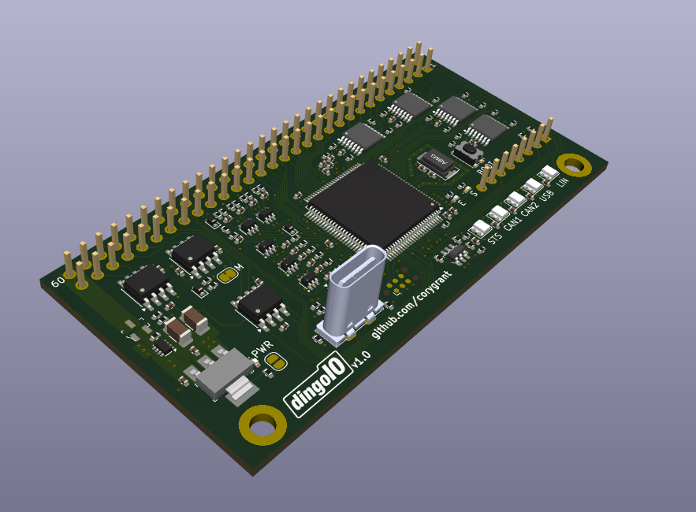

# Hardware

## Current

### dingoPDM `v7`

### dingoPDM-Max `v1`

### CANBoard `v2`

### LINBoard `v1`

## Design

I've started working on a new set of hardware designs to update the existing set of designs which are getting older and used a set of constraints/decisions that were driven by the state of hobby electronics in 2020/2021. 

Some of the design constraints/decisions:
- Move away from `0805` only components to `0402` now that PCB assembly is so much cheaper and faster
  - This allows my designs to be much more compact
- Still prefer single side assembly wherever possible
- Use a single STM32 family across all devices
  - `STM32G474`
  - Different packages for different size designs
- Simplify design and manufacturing of custom PDMs or other boards
  - Move MCU, analog, USB, CAN, etc. to daughterboard
  - PDM board contains only 12V->5V and Profets
- Create a daughterboard that can be used across multiple devices
  - Simplifies ordering and inventory for me
  - Also simplifies firmware, documentation, etc.
  - Keep the connector to the mainboard on one edge to reduce mainboard size
- Still prefer low cost and easily accessible solutions where possible
  
### dingoIO `v1`

- `v1.0 boards on hand`
- 60 pin header
- Size of 2x CANBoards (40mmx80mm)
- STM32G474VET3 (100 LQFP)
- 5V powered (onboard LDO -> 3.3v)
- 2x CAN
- 1x LIN
- USB-C (vertical)
- 1x I2C
- 6x digital inputs
- 4x analog inputs (scaled)
- 16x analog inputs (raw)
- 5x Neopixels, with Neopixel output
- Additional 8 pin header
- 6x GPIO pins (raw)
- 1x I2C
  
### dingoPDM `v8`

- `Design - Complete`
- `v1.0 not ordered yet`
- Uses dingoIO as a daughterboard
- 16x 13A outputs
  - 4x w/ large flybacks
- 2x DT-12
- 1x DTM-12
- M6 battery and ground lugs
- 2x CAN
- 1x LIN
- 6x digital inputs w/ ESD
- 4x analog inputs w/ ESD
- 1x FRAM/EEPROM (optional)

## Future

### CANBoard `v3` 

- `Design - active`
- dingoIO-Mini?
- Updated CANBoard
- Same 40mmx40mm size
- STM32G474CET3 (48 LQFP)
  
### dingoPDM-Mini `?`

- `Design - haven't started`
- Smaller dingoPDM, similar to v7
- Uses dingoIO as a daughterboard
- 8x 13A outputs
  - 4x w/ large flybacks
- M6 battery and ground lugs
- 1x CAN
- 1x LIN
- 2x digital inputs
- 1x FRAM/EEPROM (optional)

### dingoIO-Base `?`

- `Design - haven't started`
- Adds a connector to dingoIO
- Additional analog input scaling for dingoIO raw inputs
- Optional CAN termination resistors

# Firmware

## Current Supported Hardware

- dingoPDM `v7`
- dingoPDM-Max `v1`
- CANBoard `v2`
- LINBoard `v1`
- PT-DPDM `v1`

## New Hardware (To Add)
- dingoIO `v1`
- dingoPDM `v8`
- CANBoard `v3`

## New Features to Add

See [dingoElec project](https://github.com/users/corygrant/projects/4)

## New Features to Discuss

1.  PWM output frequency from a signal, duty slew, PWM on CANBoard DO1–DO4
    - This may be possible and I think I had it enabled at one point, but I think I disabled this because the flash size is so small on the F303K8
2.  Warning limit and open-load detection (report only, the output keeps running)
    - The warning limit is a percentage of the limit? 
    - And open-load is also a low percentage limit?
3.  Trip log with the current waveform around each trip, read over CAN
    - How does this work? 
4.  Output bench test: force on or PWM for a limited time
    - I've avoided any sort of "force output" functionality to avoid accidentaly turning it on on by accident
    - I like the time limit idea though
5.  CAN robustness: full RX FIFO drain, 48-frame CANBoard mailbox, back-off when frames go unacknowledged (no frame loss on a busy bus)
    - Can you explain this one some more? 
6.  Fueltech FTCAN support
    - Awhile back I had a lot of requests for this
    - Fueltech uses a weird implementation of extended IDs
    - Not sure how popular they are in the rest of the world, but they're really popular here in the US
7.  Add vehicle functions: wrapped up helper functions
    - Ignition, headlights, tailights, turn signals and hazards, interior lights, horn
8.  Add Ignition function
    - https://github.com/corygrant/dingoFW/pull/67
    - https://github.com/corygrant/dingoFW/pull/69
    - https://github.com/corygrant/dingoFW/pull/70
    - https://github.com/corygrant/dingoFW/pull/71
    - https://github.com/corygrant/dingoFW/pull/72
    - https://github.com/corygrant/dingoFW/pull/73
    - https://github.com/corygrant/dingoFW/pull/74
9.  Add CAN message block
    - https://github.com/corygrant/dingoFW/pull/68

# Software

## New Features to Add

See [dingoElec project](https://github.com/users/corygrant/projects/4)

## New Features to Discuss

1. Works on a flooded bus
   - Is this referring to config read/write?
   - I think I made some progress on this in the dev build
2. Discovery with Add from CAN
   - This is to detect devices based on the messages they're sending?
3. System view: every module, car-layout map
    - This is a way to assign the device cards to a generic car image? 
4. Vehicle worst-case load
    - This would sum the total max of every output? 
5. CAN-ID conflict guard with Suggest free base ID
    - How would the conflict guard work? Prevent the user from entering a conflicting range? 
6.  Shutdown & sleep sequence designer
    - What does this mean? 
7.  Trip log viewer, bench test, wire gauge / voltage-drop hints
    - What does the trip log viewer do? 
    - Bench test, maybe with a time limit
    - What is the wire gauge/voltage drop hints? 
8.  Single-file exe with the UI built in, unit tests and CI
    - What advantages would this have?
    - The current structure is a backend and a web front end, which enables different use cases
9.  Recently opened projects on the home page
    - Seems like a nice feature to add
10. Vehicle functions: wrapped up helper functions
    - Ignition, headlights, tailights, turn signals and hazards, interior lights, horn
    - https://github.com/corygrant/dingoConfig/pull/71
    - I like the idea, but I'm concerned that its easy to configure these vehicle functions to be specific to our use cases. 
    - How can we make these more generic or universal? 
    - Maybe Lua? 
11. Learn a switch from the bus
    - https://github.com/corygrant/dingoConfig/pull/74

# Simulator

[Coffee's simulator](https://github.com/Coffee0297/CoffeeDingoSim) looks really mature, there's no reason to build anything else. 

I need to spend some more time playing with it to offer any ideas, but it's awesome that it uses Renode. 

# Documentation

- This is becoming a huge open issue as more and more things get added. 