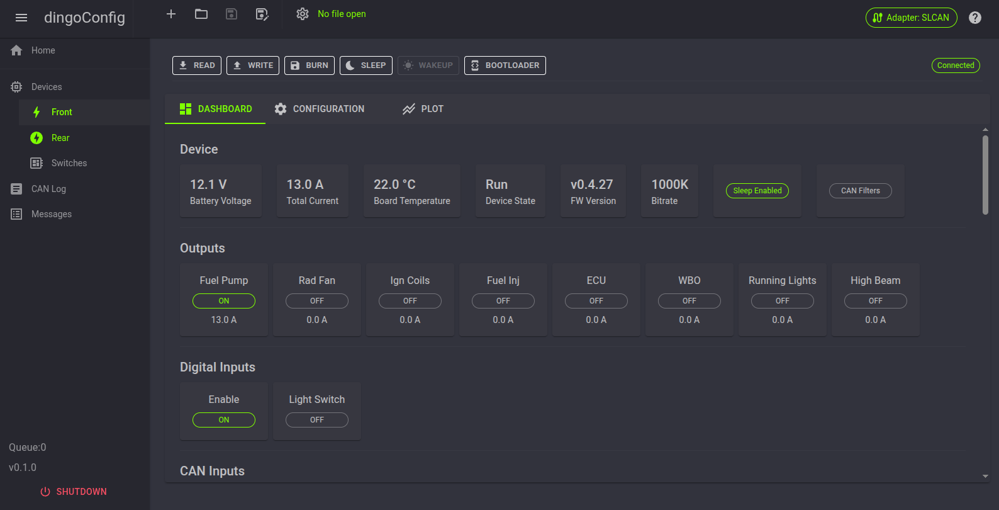

dingoConfig is a cross-platform application to configure and monitor dingoElectronics devices and other CAN devices.

It runs on Windows, Linux and macOS. The app runs a small local web server and the UI opens in your web browser.

!!! Note
    dingoConfig replaces DingoConfigurator, which is no longer supported. dingoConfig requires dingoFW `v0.5.1` or later.

{ width="800" }

## Download

The latest version can be downloaded here: [dingoConfig Releases](https://github.com/corygrant/dingoConfig/releases)

Download the `.zip` for your system:

| System                       | File                                |
| ---------------------------- | ----------------------------------- |
| Windows                      | `dingoConfig-X.X.X-win-x64.zip`     |
| Windows on ARM               | `dingoConfig-X.X.X-win-arm64.zip`   |
| Linux                        | `dingoConfig-X.X.X-linux-x64.zip`   |
| Linux ARM (Raspberry Pi)     | `dingoConfig-X.X.X-linux-arm64.zip` or `linux-arm32` |
| macOS (Apple Silicon)        | `dingoConfig-X.X.X-osx-arm64.zip`   |
| macOS (Intel)                | `dingoConfig-X.X.X-osx-x64.zip`     |

## Installation

No install is needed, .NET is included in the download.

1. Unzip the download
2. Run `dingoConfig` (`dingoConfig.exe` on Windows)
3. Your web browser opens to `http://localhost:5000`

If the browser doesn't open, open `http://localhost:5000` manually. If dingoConfig is already running, the browser opens to the running copy.

To close dingoConfig, press `Shutdown` at the bottom of the menu.

!!! Info "Linux"
    - Make the file executable: `chmod +x dingoConfig`
    - To use USB or SLCAN serial ports, add your user to the `dialout` group: `sudo usermod -aG dialout $USER`, then log out and back in

!!! Info "Firmware updates"
    [STM32CubeProgrammer](https://www.st.com/en/development-tools/stm32cubeprog.html) is needed to [update firmware](../dingofw/updating.md). It is not needed to run dingoConfig.

## Quick Start

1. Connect the device with USB, or connect a CAN adapter to the CAN bus
2. Press the `Adapter` button in the top right, select the [adapter](./adapters.md), port and bitrate, and connect
3. Go to `Devices` and [add a device](./devices.md#adding-a-device) with the device's Base ID
4. Open the device page, the device shows `Connected` when its messages are received
5. Press `Read` to read the configuration from the device
6. Change settings on the `Configuration` tab
7. Press `Write` to send the changes, then `Burn` to save them on the device
8. Save a [config file](./configfiles.md)

## Supported Devices

| Manufacturer          | Device                                                    |
| :-------------------- | :-------------------------------------------------------- |
| dingoElectronics      | [dingoPDM](https://github.com/corygrant/dingoPDM)         |
| dingoElectronics      | [dingoPDM-Max](https://github.com/corygrant/dingoPDM-Max) |
| dingoElectronics      | [CANBoard](https://github.com/corygrant/CANBoard)         |
| Blink Marine          | [CANopen keypads](./keypads.md)                           |
| Grayhill              | [CANopen keypads](./keypads.md)                           |
| Any                   | [DBC Device](./dbcdevice.md), any device with a DBC file  |

## Supported CAN Interfaces

| Manufacturer | Interface                                     |
| :----------- | :-------------------------------------------- |
| dingoElectronics | dingoPDM / dingoPDM-Max USB, also works as a USB to CAN adapter for the whole bus |
| Any          | [SLCAN](./adapters.md#slcan) serial adapters (CANable, [USB2CAN](https://github.com/corygrant/USB2CAN_HW), etc.) |
| Any          | [SocketCAN](./adapters.md#socketcan) (Linux only) |
| PEAK-System  | [PCAN-USB](https://www.peak-system.com/PCAN-USB.199.0.html?&L=1) |

See [Adapters](./adapters.md)

## Technology

dingoConfig is built using:

| Name                                                        | Function             |
| :---------------------------------------------------------- | :------------------- |
| [C# .NET](https://dotnet.microsoft.com/)                     | Backend              |
| [Blazor Server](https://learn.microsoft.com/aspnet/core/blazor/) | Frontend / UI    |
| [MudBlazor](https://mudblazor.com/)                          | UI Objects and Theme |
| [uPlot](https://github.com/leeoniya/uPlot)                   | Plots                |

## Contributing

See [CONTRIBUTING.md](https://github.com/corygrant/dingoElec/blob/main/CONTRIBUTING.md) and the [dingoConfig repo](https://github.com/corygrant/dingoConfig).
