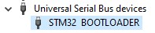
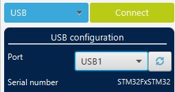
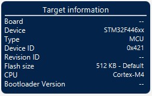
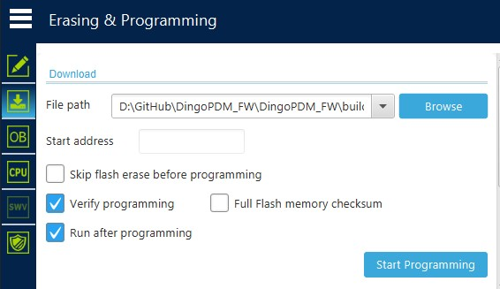
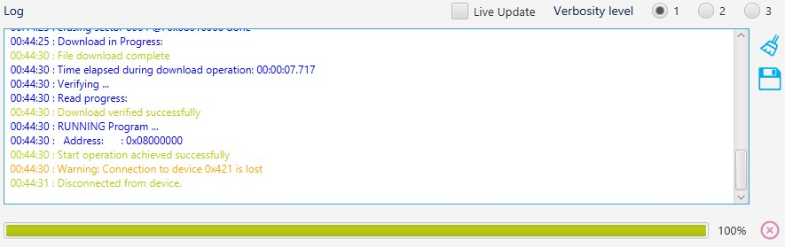

# Updating Firmware

dingoPDM and dingoPDM-Max firmware is updated using the onboard USB-C connection and the STM32 USB bootloader. 

CANBoard does not have USB, see [CANBoard](#canboard).

## Latest Firmware

The latest built firmware can be found on [the release page](https://github.com/corygrant/dingoFW/releases). 

Download the `.hex` file for your board:

| Device       | File                           |
| ------------ | ------------------------------ |
| dingoPDM     | `dingopdm_v7_FW_vX-X-X.hex`    |
| dingoPDM-Max | `dingopdmmax_v1_FW_vX-X-X.hex` |
| CANBoard     | `canboard_v2_FW_vX-X-X.hex`    |

!!! Warning
    Some firmware updates change the configuration format. The device will start with the default configuration after one of these updates.

    Save your configuration to a file in dingoConfig before updating. After updating, open the file, `Write All` and `Burn`. See [Configuration Storage](./configuration.md#read-failure).

## STM32CubeProgrammer

To update the firmware, the STMicroelectronics STM32CubeProgrammer is used. 

This software can be downloaded here: [STM32CubeProgrammer](https://www.st.com/en/development-tools/stm32cubeprog.html)

## Entering Bootloader

To update the firmware, the device must be put into the bootloader. 

This can be done using one of these methods:

* Use the dingoConfig [Bootloader button](#bootloader-button) to jump the device to the bootloader
* Remove the case and move the [boot switch](#boot-switch) to the bootloader position

### Bootloader Button

After connecting to the device in dingoConfig, open the device page and press `Bootloader`. This sends the [Bootloader request](./can.md#bootloader) and the device jumps to the STM32 bootloader.

The bootloader request works over USB or CAN, but the update itself must be done over USB.

!!! Warning
    Pressing the `Bootloader` button will turn off all outputs and drop communication with dingoConfig

!!! Tip
    Disconnect dingoConfig from the USB adapter (or close dingoConfig) before connecting with STM32CubeProgrammer.

### Boot Switch

Another option is the `boot` switch on the PCB. 

!!! Note
    The case must be removed to access the boot switch.

    * Remove the DT connector and any wires going to the power/ground connections
    * Remove the 2x Philips screws next to the DT connector
    * Remove the 4x M6 screws around the perimeter of the device
    * Slide/wiggle the case up and off the device

To enter the bootloader, move the slide switch to the position that aligns it with the lines on the switch body

{ width="100", .off-glb }
{ width="100", .off-glb }

!!! Warning
    After updating, remember to set the boot switch back to the original position

!!! Danger
    A POWER CYCLE IS REQUIRED any time the boot switch is changed

## Connection

Connect a USB cable to the PC. 

!!! Note
    V7.2 PCBs do not support USB-C to USB-C cables, a USB-C to USB-A cable must be used

!!! Note
    12V power is not required to perform the firmware update, the device will be powered by the USB cable

To verify that the device has entered the bootloader on Windows:

* Open the Windows `Device Manager`
* Expand `Universal Serial Bus devices`
* The `STM32 BOOTLOADER` should be listed
* { width="300" }

On Linux, `lsusb` should list `STMicroelectronics STM Device in DFU Mode`.

## Applying Update

* Install `STM32CubeProgrammer`
* Open `STM32CubeProgrammer`
* Change connection type to `USB`
* Press the refresh button to update the port

* { width="300" }

* Press the `Connect` button, after successful connection the `Target Information` should be updated
* { width="300" }
* Select the second icon on the left, `Erasing & Programming`
* { width="500" }
* Press `Browse` and select the new firmware `.hex` file
* Verify `Skip flash erase before programming` is unchecked
* Verify `Verify programming` and `Run after programming` are checked
* Press `Start Programming`
* After successful programming, the device will disconnect
* You should also receive pop-ups verifying successful programming
* { width="800" }

## Success

Congrats! You successfully updated the firmware. 

The firmware version is shown in dingoConfig on the device page.

!!! Warning
    If you used the boot switch, don't forget to set it back to the original position and cycle power!

## CANBoard

CANBoard has no USB connection. It is programmed through the SWD pads with an ST-Link and a [Tag-Connect TC2030](https://www.tag-connect.com/product/tc2030-ctx-nl-stdc14-for-use-with-stm32-processors-with-stlink-v3) cable.

* Connect the ST-Link and Tag-Connect cable
* Open `STM32CubeProgrammer` and change the connection type to `ST-LINK`
* Press `Connect`
* Program the `canboard_v2_FW_vX-X-X.hex` file the same way as [above](#applying-update)
