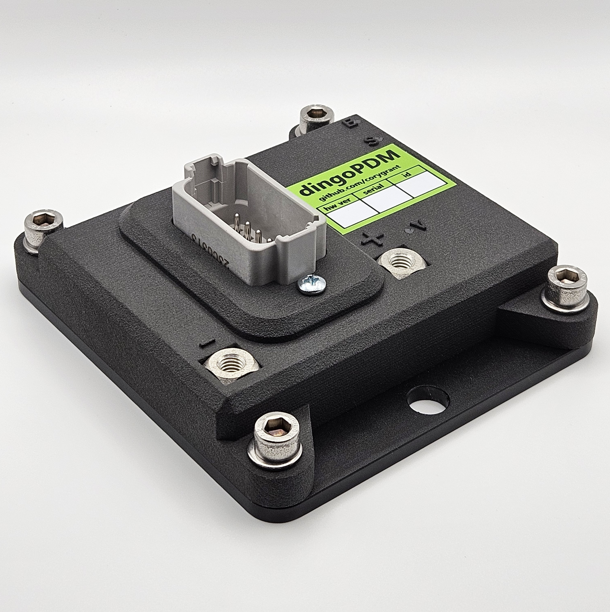
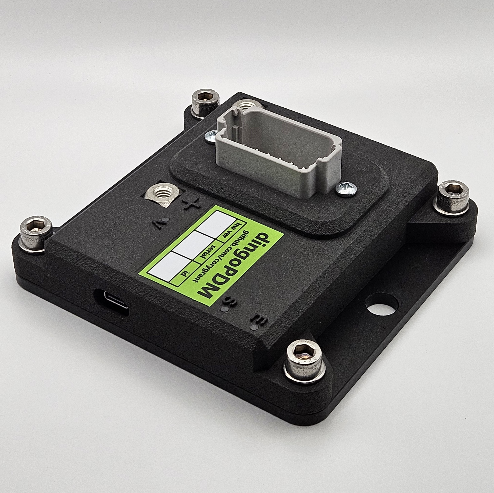
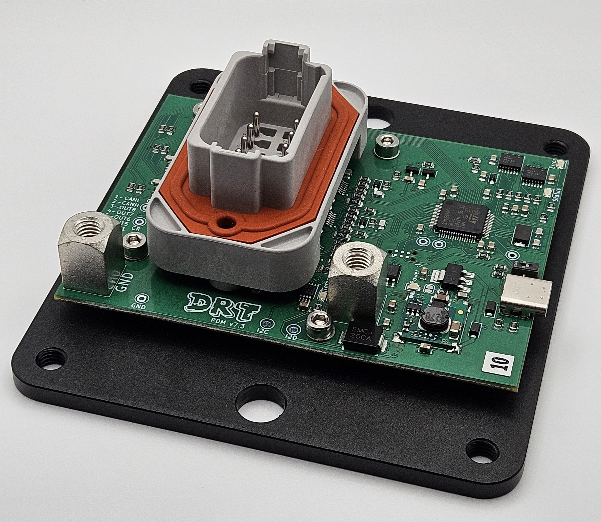
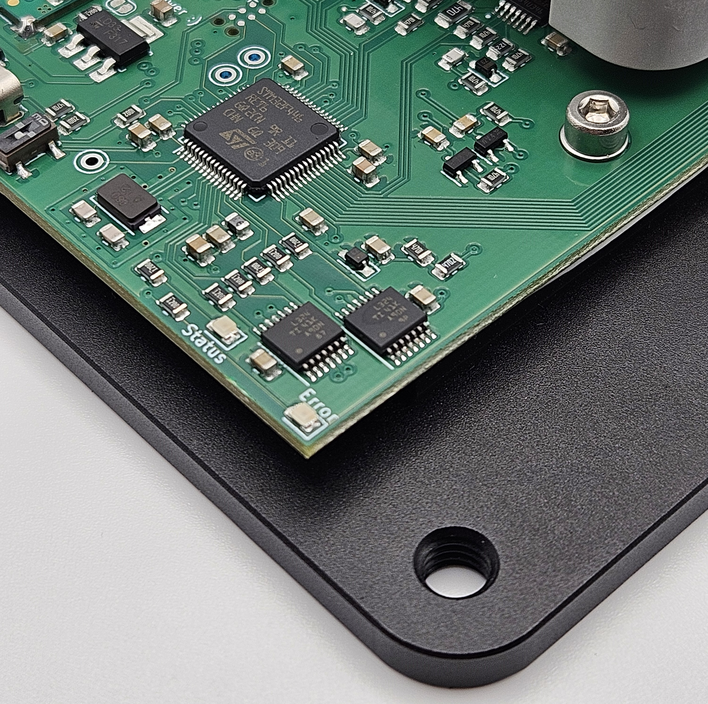

## What Is It?

dingoPDM is an automotive `Power Distribution Module`. 

PDMs can be used in place of fuses, circuit breakers and relays, including flasher and wiper relays. 

Each output channel of the PDM:
 
- Measures the active current and reacts by turning the output off if the current exceeds the limit
- Allows a higher inrush current when first turned on
- Automatically resets after a cool down period a maximum number of times
- Can be turned on/off using various input sources
- Can be on constantly or with Pulse Width Modulation (PWM)

This makes PDMs a very flexible solution when designing the power system in any automotive application. 

## Features

A key feature of any PDM is flexible configuration to match the target application. 

To meet these needs, dingoPDM includes configurable:

- Outputs, including paired outputs for higher current loads
- Digital inputs
- CAN inputs (32), read any signal from any CAN message
- CAN outputs (32), send any value on CAN
- Virtual logic inputs (16)
- Counters (4)
- Logic conditions (32)
- Timers (8)
- Wipers
- Flashers (4)
- Starter disable

All settings on the dingoPDM are configured with [dingoConfig](../dingoconfig/introduction.md), which runs on Windows, Linux and macOS. See [dingoPDM Configuration](../dingoconfig/dingopdm.md) for every setting.

dingoPDM also includes:

- Cyclic CAN status messages (TX), see [CAN](../dingofw/can.md#cyclic-messages)
- Pulse Width Modulation (PWM)
    - Configurable frequency (up to 400Hz)
    - Fixed or variable duty cycle
    - Soft start
- CAN keypad support, up to 2 keypads
    - [Blink Marine and Grayhill](../dingofw/keypad.md)
- Battery voltage measurement
- Board temperature sensor
- Low power [sleep](../dingofw/sleep.md)
- Status LEDs

## Configuration

The dingoPDM configuration can be accessed using:

- USB-C connected directly to the device. With `Connect USB to CAN` enabled (default), the USB port also works as a USB to CAN adapter, so every device on the CAN bus can be configured through it
- A CAN connection to one or many devices at once using a USB to CAN adapter such as [USB2CAN](https://github.com/corygrant/USB2CAN_HW), see [Adapters](../dingoconfig/adapters.md)

Configuration reading/writing and status monitoring are all done using [dingoConfig](../dingoconfig/introduction.md)

## Wiring Example

{ .off-glb }
{ .off-glb }

## Changing the CAN Base ID

The default CAN Base ID is `0x0DE` (222). Each device on the bus uses the IDs from `Base ID` to `Base ID + 28`, see [CAN IDs](../dingofw/can.md#ids).

To change the Base ID in dingoConfig:

1. Connect to the device
2. On the `Devices` page, press `Modify Device` and enter the new Base ID. dingoConfig sends the new Base ID to the device and starts using it
3. Open the device and press `Burn` to save the new Base ID on the device

To change the CAN bitrate:

1. On the device `Configuration` tab, `Device` section, change `Bitrate`
2. Press `Write`, then `Burn`
3. Press `Reset` (or cycle power), the device starts using the new bitrate
4. Reconnect the [adapter](../dingoconfig/adapters.md) at the new bitrate (not needed for USB)

## Images

